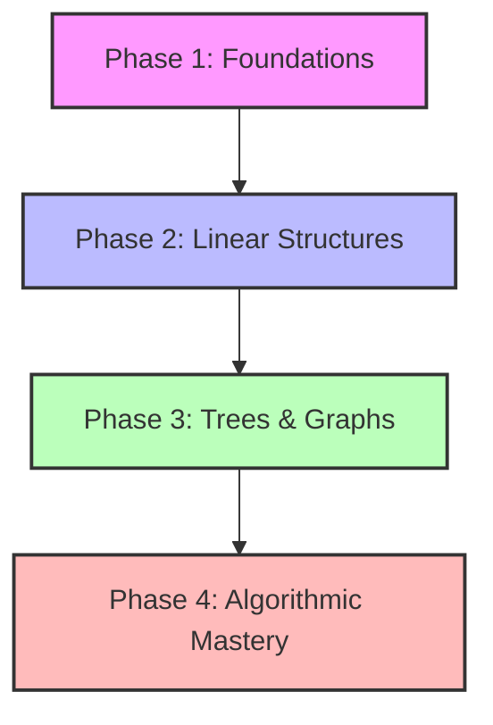

# ⚡ Dev Agarwal's DSA Command Center

<div align="center">
  
</div>

<p align="center">
  <a href="https://github.com/devagarwal2503">
    
  </a>
  
  
</p>

---

## 📖 The Quest & The Mentor

This repository is my personal sandbox for mastering Data Structures & Algorithms (DSA). 

While I am following the structured learning roadmap from **[Padho with Pratyush's DSA Patterns Playlist](https://www.youtube.com/playlist?list=PLbJhGqY-mq47k_WLUtzVjmarUm1EuXPj2)**, this space represents **my personal implementation, optimization style, and growth**.

Here, I focus on **intuition over memorization**. Instead of solving 1000+ scattered problems, I am training my brain to recognize the pattern underlying each challenge.

---

## 🛡️ Dev's Rules of the Arena

To get the most out of this journey and prevent passive learning, I hold myself to these rules:

1. **The 30-Minute Struggle:** No checking the editorial or video solutions before actively trying for at least 30 minutes.
2. **Dry Run First:** Before typing a single line of code, dry-run the logic on paper with at least two custom edge cases.
3. **Double Pass Optimization:** First make it run (Brute Force), then make it fast/efficient (Optimal).
4. **Document the "Aha!" Moment:** Every solved problem must contain a comment detailing *why* the optimal approach works.

---

## 🏆 Quest Progression Tracker

I have categorized the patterns into four logical phases. My goal is to conquer each phase step-by-step.



### ⚔️ Phase 1: Linear Foundations
| Module | Pattern | Status | Key Milestones | Notes |
|:---:|---|:---:|:---:|---|
| **00** | Complexity Analysis | 🔄 *Analyzing* | Big O, Space Tricks | Learning to count operations |
| **01** | Two Pointers | 🟥 *Locked* | Opposite & Same Direction | Left/Right index manipulation |
| **02** | Sliding Window | 🟥 *Locked* | Fixed & Variable Windows | Subarrays & unique characters |
| **03** | Prefix Sum | 🟥 *Locked* | Range Sum Queries | Precomputing static arrays |
| **04** | Merge Intervals | 🟥 *Locked* | Interval Overlaps | Sorting & interval insertions |

### ⚔️ Phase 2: Classic Data Structures
| Module | Pattern | Status | Key Milestones | Notes |
|:---:|---|:---:|:---:|---|
| **05** | Binary Search | 🟥 *Locked* | Rotated search, Search Space | $O(\log N)$ optimization everywhere |
| **06** | Linked Lists | 🟥 *Locked* | In-place Reversal, Tortoise-Hare | Pointer rewiring & cycle checks |
| **07** | Monotonic Stack/Queue | 🟥 *Locked* | Next Greater Element | Tracking order invariants |
| **08** | Heaps & Priority Queues | 🟥 *Locked* | K-way Merge, Top K elements | Dynamic min/max maintenance |

### ⚔️ Phase 3: Non-Linear Structures & Networks
| Module | Pattern | Status | Key Milestones | Notes |
|:---:|---|:---:|:---:|---|
| **09** | Trees & BST | 🟥 *Locked* | DFS/BFS traversals, LCA | Recursive tree properties |
| **10** | Graphs | 🟥 *Locked* | Dijkstra, Topo Sort, DSU, MST | Network connectivity & shortest paths |
| **11** | Trie | 🟥 *Locked* | Auto-complete, Prefix matching | Space-efficient string indices |

### ⚔️ Phase 4: Algorithmic Mastery
| Module | Pattern | Status | Key Milestones | Notes |
|:---:|---|:---:|:---:|---|
| **12** | Recursion & Backtracking | 🟥 *Locked* | Subsets, Permutations, Sudoku | Pruning search spaces |
| **13** | Greedy Algorithms | 🟥 *Locked* | Interval Scheduling, Knapsack | Local optimal to global optimal |
| **14** | Dynamic Programming (DP) | 🟥 *Locked* | Memoization & Tabulation | Overlapping subproblems, States |
| **15** | Bit Manipulation | 🟥 *Locked* | Bitmasks, Single Numbers | Low-level math speedups |

---

## 🛠️ Dev's C++ Weapon of Choice (Template)

For my local testing, I don't use standard boilerplate. I use a custom template that includes **Fast I/O**, standard containers, and a **local-only debugger macro** that prints variables without polluting LeetCode's compiler output.

```cpp
#include <bits/stdc++.h>
using namespace std;

// Short-hands for standard containers
using ll = long long;
using vi = vector<int>;
using pii = pair<int, int>;

// Local debugging engine
#ifndef ONLINE_JUDGE
#define debug(x) cerr << #x <<" = "; _print(x); cerr << endl;
#else
#define debug(x)
#endif

// Debug print overloads
void _print(int t) { cerr << t; }
void _print(string t) { cerr << t; }
void _print(char t) { cerr << t; }
void _print(double t) { cerr << t; }
template <class T> void _print(vector<T> v) { cerr << "[ "; for (T i : v) { _print(i); cerr << " "; } cerr << "]"; }

// Fast I/O Configuration
void fast_io() {
    ios_base::sync_with_stdio(false);
    cin.tie(NULL);
}

class Solution {
public:
    int solvePatternProblem(vi& nums) {
        // Intuition and pattern implementation here
        return 0;
    }
};

int main() {
    fast_io();
    
    #ifndef ONLINE_JUDGE
    // Redirecting input and output locally if needed
    // freopen("input.txt", "r", stdin);
    // freopen("error.txt", "w", stderr);
    #endif

    Solution solver;
    vi nums = {1, 2, 3, 4, 5};
    
    debug(nums); // Prints only in local debug build!
    
    return 0;
}
```

---

## 📂 Project Organization

This is how I keep my codebase neat and clean:

```text
DSA-Learning/
├── README.md                      # Command center
├── 00_Complexity_Analysis/        # Theoretical and space tricks
├── 01_Two_Pointers/               # Fast-slow, opposite end problems
│   ├── remove_duplicates.cpp      # Annotated clean C++ code
│   └── Notes.md                   # My personal takeaways and intuition
└── ...
```

---

## 📈 Milestones & Achievements

*   📅 **Quest Started:** July 22, 2026
*   🚀 **Level 1 Reached:** (Lock Complexity Analysis basics)
*   🔥 **Streak Goal:** Solve at least 1 problem daily.

---

*“The only way to learn a new programming language or tool is by writing programs in it.” – Dennis Ritchie* 

Let's do this! 💪
