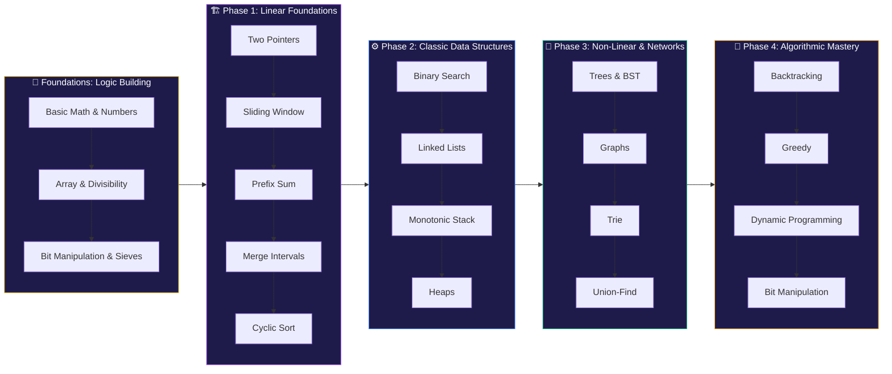
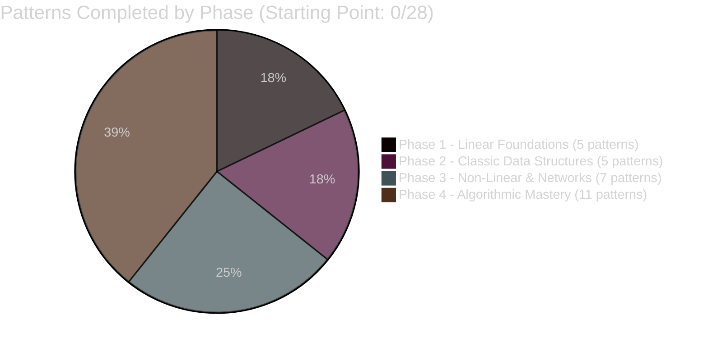
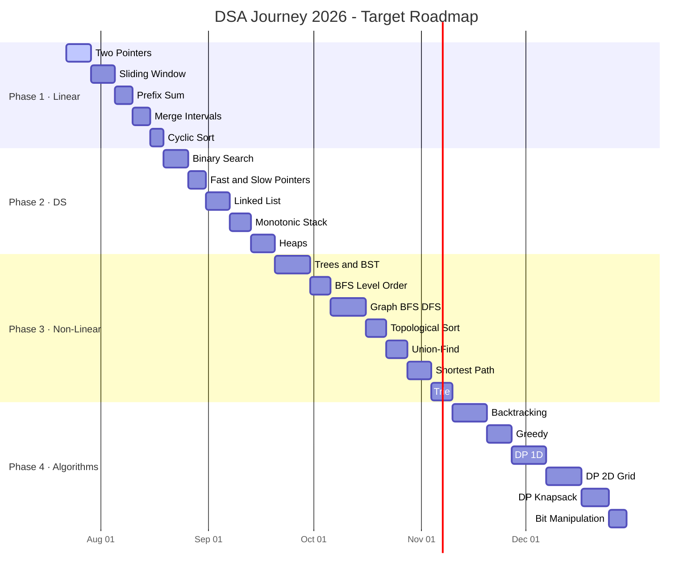
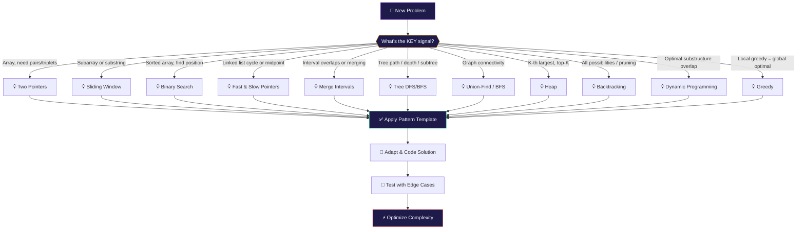

<div align="center">

<h1>🧠 Dev Agarwal's DSA Journal</h1>


<br/>

<a href="https://www.youtube.com/@padho_with_pratyush">
  
</a>
<a href="https://www.youtube.com/playlist?list=PLbJhGqY-mq47k_WLUtzVjmarUm1EuXPj2">
  
</a>
<a href="https://docs.google.com/spreadsheets/d/1T5-nGsJ9WNwna44e9WWRD0jlZIT5KxVOGvylcvvVrY8/edit?usp=sharing">
  
</a>
<a href="https://github.com/devagarwal2503">
  
</a>

<br/><br/>


</div>

---

## 🧭 The Mission: Pattern-First DSA

> *"An algorithm must be seen to be believed — and a person who cannot visualize a pattern cannot truly understand it."*
> — **Donald Knuth**, Author of *The Art of Computer Programming*

Traditional DSA prep is broken. You grind 500 LeetCode problems, yet freeze in interviews because you memorized *solutions* — not *thinking strategies*.

I'm taking a different path. Instead of grinding topic-by-topic (Arrays → Strings → Trees…), I'm training my brain to recognize **28 core algorithmic patterns** that solve ~95% of all interview problems. When I see a new problem, I identify the pattern, apply the template, and adapt.

This repo is the living record of that journey — **my notes, my code, my "Aha!" moments.** I'm following the [DSA Patterns 2025](https://www.youtube.com/playlist?list=PLbJhGqY-mq47k_WLUtzVjmarUm1EuXPj2) course as my structured curriculum.

---

## 📡 Learning Stack

| | Details |
|---|---|
| **Course** | [DSA Patterns 2025](https://www.youtube.com/playlist?list=PLbJhGqY-mq47k_WLUtzVjmarUm1EuXPj2) — Padho with Pratyush |
| **Problem Sheet** | [Official Pattern Sheet](https://docs.google.com/spreadsheets/d/1T5-nGsJ9WNwna44e9WWRD0jlZIT5KxVOGvylcvvVrY8/edit?usp=sharing) |
| **Core Philosophy** | Pattern recognition > Rote memorization |
| **Target** | FAANG & Product-Based Company Interviews |
| **My Language** | C++20 |

---

## ⚔️ Dev's Code of Conduct

Before a single line of code, I commit to these rules:

| # | Rule | Why |
|---|---|---|
| 1 | **The 30-Minute Struggle Rule** | No editorial or video solution before genuinely trying for ≥30 min |
| 2 | **Dry Run on Paper First** | Trace logic with ≥2 custom edge cases before coding |
| 3 | **Brute → Optimal** | First make it work, then make it fast |
| 4 | **The "Aha!" Comment** | Every solution has a comment explaining the core insight |
| 5 | **Pattern Tag Every Solution** | Label which pattern applies (e.g., `// PATTERN: Sliding Window`) |

---

## 🗺️ The Learning Roadmap



---

## 📊 Master Progress Tracker

> **Legend:** 🔒 Locked &nbsp;|&nbsp; 🔄 In Progress &nbsp;|&nbsp; 🧪 Practicing &nbsp;|&nbsp; ✅ Completed

### 🎯 Foundations — GFG Logic Building
Before entering the pattern-based quest, I am conquering 46 math and logic building problems on GFG to set a strong baseline. Progress is tracked sub-folder by sub-folder.

Detailed problem sheet is available at: [Basic/problems.md](./Basic/problems.md)

| Category | Description | Problems | Link | Status |
|:---:|---|:---:|:---:|:---:|
| 🟢 **Basic** | Foundational arithmetic & basic logic loops | 5/5 | [View](./Basic/Basic/) | ✅ Completed |
| 🔵 **Easy** | Prime checks, GCD/LCM, sequence math, fractions | 7/17 | [View](./Basic/Easy/) | 🔄 In Progress |
| 🟡 **Medium** | Divisibility checks, combinatorics, large exponentiation | 0/16 | [View](./Basic/Medium/) | 🔒 Locked |
| 🔴 **Hard** | Prime sieves, recursion basics (Tower of Hanoi), Josephus | 0/8 | [View](./Basic/Hard/) | 🔒 Locked |

---

### ⚡ Phase 1 — Linear Foundations

| # | Pattern | Core Concepts | Problems | Status | Difficulty |
|:---:|---|---|:---:|:---:|:---:|
| 01 | **Two Pointers** | Opposite ends, same dir, Dutch National Flag | 0/12 | 🔒 Locked | 🟢 Easy |
| 02 | **Sliding Window** | Fixed window, variable window, character maps | 0/15 | 🔒 Locked | 🟢 Easy |
| 03 | **Prefix Sum** | Range queries, 2D prefix, difference arrays | 0/10 | 🔒 Locked | 🟢 Easy |
| 04 | **Merge Intervals** | Interval sorting, overlapping, insertion | 0/8 | 🔒 Locked | 🟡 Medium |
| 05 | **Cyclic Sort** | Index-based placement, missing/duplicate numbers | 0/6 | 🔒 Locked | 🟡 Medium |

### ⚙️ Phase 2 — Classic Data Structures

| # | Pattern | Core Concepts | Problems | Status | Difficulty |
|:---:|---|---|:---:|:---:|:---:|
| 06 | **Binary Search** | Rotated arrays, search space reduction, 2D binary search | 0/14 | 🔒 Locked | 🟡 Medium |
| 07 | **Fast & Slow Pointers** | Cycle detection, middle of list, tortoise-hare | 0/8 | 🔒 Locked | 🟡 Medium |
| 08 | **Linked List Manipulation** | In-place reversal, K-group reversal, rotation | 0/10 | 🔒 Locked | 🟡 Medium |
| 09 | **Monotonic Stack** | Next greater/smaller element, histogram | 0/8 | 🔒 Locked | 🔴 Hard |
| 10 | **Heaps & Priority Queues** | Top-K elements, K-way merge, scheduling | 0/10 | 🔒 Locked | 🔴 Hard |

### 🌳 Phase 3 — Non-Linear Structures

| # | Pattern | Core Concepts | Problems | Status | Difficulty |
|:---:|---|---|:---:|:---:|:---:|
| 11 | **Trees & BST** | DFS/BFS, LCA, diameter, serialization | 0/14 | 🔒 Locked | 🟡 Medium |
| 12 | **Tree BFS / Level Order** | Level traversal, zigzag, right side view | 0/8 | 🔒 Locked | 🟡 Medium |
| 13 | **Graphs — BFS/DFS** | Connected components, flood fill, word ladder | 0/12 | 🔒 Locked | 🔴 Hard |
| 14 | **Topological Sort** | Course schedule, alien dictionary, DAG ordering | 0/6 | 🔒 Locked | 🔴 Hard |
| 15 | **Union-Find / DSU** | Cycle detection, redundant connection | 0/8 | 🔒 Locked | 🔴 Hard |
| 16 | **Shortest Path** | Dijkstra, Bellman-Ford, Floyd-Warshall | 0/8 | 🔒 Locked | 🔴 Hard |
| 17 | **Trie** | Prefix matching, autocomplete, word search | 0/6 | 🔒 Locked | 🔴 Hard |

### 🧩 Phase 4 — Algorithmic Mastery

| # | Pattern | Core Concepts | Problems | Status | Difficulty |
|:---:|---|---|:---:|:---:|:---:|
| 18 | **Recursion & Backtracking** | Subsets, permutations, N-queens, Sudoku | 0/12 | 🔒 Locked | 🔴 Hard |
| 19 | **Greedy Algorithms** | Interval scheduling, activity selection | 0/10 | 🔒 Locked | 🔴 Hard |
| 20 | **DP — 1D** | Fibonacci variants, house robber, coin change | 0/12 | 🔒 Locked | 🔴 Hard |
| 21 | **DP — 2D / Grid** | LCS, edit distance, unique paths | 0/12 | 🔒 Locked | 🔴 Hard |
| 22 | **DP — Knapsack** | 0/1 Knapsack, unbounded, subset sum | 0/10 | 🔒 Locked | 🔴 Hard |
| 23 | **DP — Intervals** | Burst balloons, matrix chain multiplication | 0/6 | 🔒 Locked | 🔴 Hard |
| 24 | **Divide & Conquer** | Merge sort variants, K-th element | 0/6 | 🔒 Locked | 🔴 Hard |
| 25 | **Bit Manipulation** | Bitmasks, XOR tricks, power of two | 0/8 | 🔒 Locked | 🟡 Medium |
| 26 | **Math & Number Theory** | GCD, prime sieve, modular arithmetic | 0/6 | 🔒 Locked | 🟡 Medium |
| 27 | **String Matching** | KMP, Rabin-Karp, Z-algorithm | 0/6 | 🔒 Locked | 🔴 Hard |
| 28 | **Segment Trees & BIT** | Range queries, point updates, lazy propagation | 0/6 | 🔒 Locked | 🔴 Hard |

---

## 📈 Skills Radar

> This chart evolves as I complete more patterns. Currently at Day 1 — all doors locked, all potential unleashed.



---

## 🔥 Pattern Unlock Timeline (Target Schedule)



---

## 📌 The Pattern-Identification Mental Model

When I see a new problem, I run through this decision tree:



---

## 📁 Repository Structure

```text
DSA-Learning/
│
├── 📄 README.md                          ← Mission Control (this file)
│
├── 📂 01_Two_Pointers/
│   ├── 📝 notes.md                       ← Concept, when-to-use, C++ template
│   ├── 📝 problems.md                    ← Problem list with LeetCode links + status
│   └── 📂 solutions/
│       └── 🔧 valid_palindrome.cpp       ← Annotated solution
│
├── 📂 02_Sliding_Window/
│   ├── 📝 notes.md
│   ├── 📝 problems.md
│   └── 📂 solutions/
│
└── 📂 [NN_Pattern_Name]/
    ├── 📝 notes.md
    ├── 📝 problems.md
    └── 📂 solutions/
        └── 🔧 [problem_name].cpp
```

---

## 🛠️ C++ Solution Template

Every problem I solve follows this exact structured template:

```cpp
/*
 * ═══════════════════════════════════════════════════════════
 *  Problem : [Problem Name]
 *  Link    : [LeetCode / GFG URL]
 *  Pattern : [Two Pointers | Sliding Window | DP | ...]
 *  Date    : [YYYY-MM-DD]
 * ═══════════════════════════════════════════════════════════
 *
 *  💡 AHA! MOMENT:
 *  [The core insight that makes the optimal approach work]
 *
 *  APPROACH:
 *  1. [Step 1]
 *  2. [Step 2]
 *
 *  ⏱️  Time  : O(?)
 *  💾  Space : O(?)
 * ═══════════════════════════════════════════════════════════
 */

#include <bits/stdc++.h>
using namespace std;

class Solution {
public:
// Let's build the logic!
    
    
};

int main() {
    Solution sol;
    
    return 0;
}
```

---

## 🏆 Achievement Wall

<div align="center">

| Badge | Milestone | Status | Date |
|:---:|---|:---:|:---:|
| 🌱 **Seed Planted** | Repository created & quest begun | ✅ Done | Jul 22, 2026 |
| 🔓 **First Unlock** | Complete Pattern #01: Two Pointers | 🔒 | — |
| 🔟 **Decade** | 10 problems solved | 🔒 | — |
| 🚀 **Phase 1 Clear** | All 5 linear patterns completed | 🔒 | — |
| 🏗️ **Phase 2 Clear** | All 5 data structure patterns completed | 🔒 | — |
| 🌐 **Non-Linear Explorer** | Begin Phase 3: Trees & Graphs | 🔒 | — |
| 🎯 **Phase 3 Clear** | All 7 non-linear patterns completed | 🔒 | — |
| 💯 **Century** | 100 problems solved | 🔒 | — |
| 🧩 **DP Disciple** | Complete all 4 DP sub-patterns | 🔒 | — |
| 🧠 **Pattern Master** | All 28 patterns completed | 🔒 | — |
| ⚡ **Final Boss** | Full mock interview (45 min, clean solve) | 🔒 | — |

</div>

---

## 📚 Key Resources

| Resource | Link | Purpose |
|---|---|---|
| 🎥 **Playlist** | [DSA Patterns 2025](https://www.youtube.com/playlist?list=PLbJhGqY-mq47k_WLUtzVjmarUm1EuXPj2) | Primary learning source |
| 📊 **Pattern Sheet** | [Google Sheets Tracker](https://docs.google.com/spreadsheets/d/1T5-nGsJ9WNwna44e9WWRD0jlZIT5KxVOGvylcvvVrY8/edit?usp=sharing) | Official problem list |
| 📺 **Channel** | [@padho_with_pratyush](https://www.youtube.com/@padho_with_pratyush) | Pratyush's full channel |
| 🧑‍💻 **My LeetCode** | [devagarwal2503](https://leetcode.com/devagarwal2503/) | Submission history |
| 📖 **C++ Reference** | [cppreference.com](https://cppreference.com) | STL documentation |

---

## 💬 Daily Problem Log

> *A breadcrumb trail of the journey. Updated after every session.*

| Date | Pattern | Problem | Approach | Time | Space | Outcome |
|---|---|---|---|:---:|:---:|:---:|
| Jul 22, 2026 | — | Repo setup & planning | — | — | — | ✅ |

---

<div align="center">

---

*"People think that computer science is the art of geniuses but the actual reality is the opposite, just many people doing things that build on each other, like a wall of mini stones."*
— **Donald Knuth**

**🧠 Built by Dev Agarwal · Quest Started July 2026**

</div>
